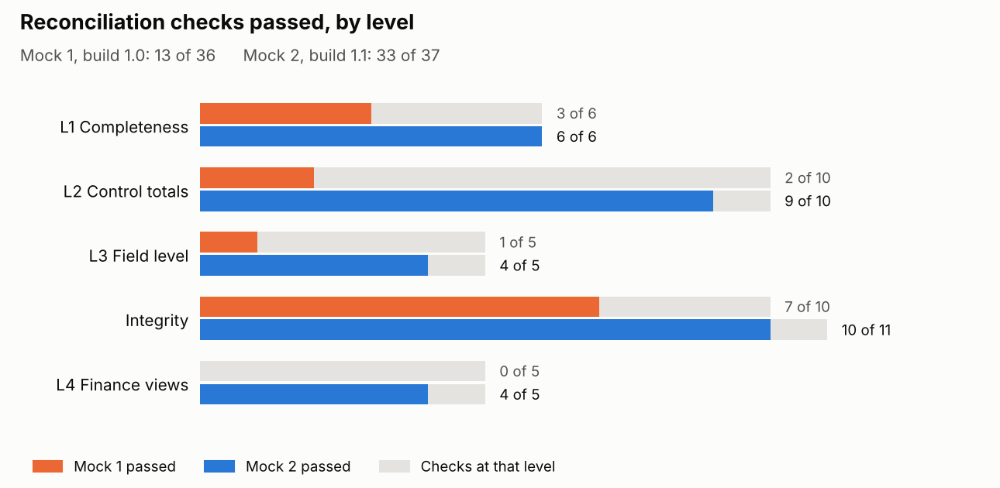
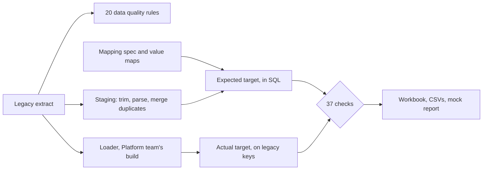
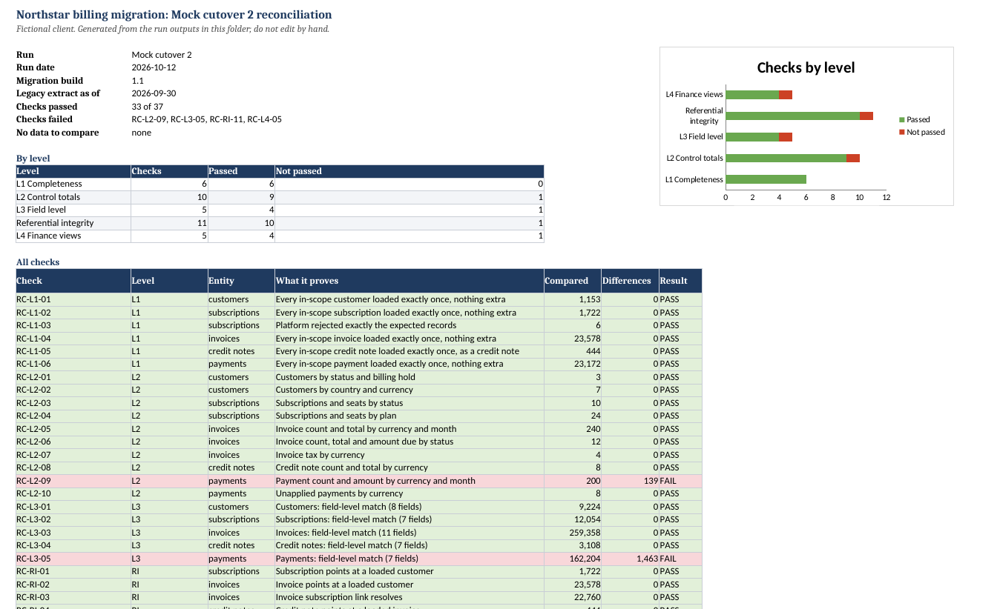

# Northstar billing migration: data mapping and reconciliation

[](https://github.com/prachitqwer/billing-migration-reconciliation/actions/workflows/tests.yml)


Moving a company's billing data from a home-grown system to a new billing platform, and proving to the Controller, to the cent, that nothing was lost, changed or loaded twice.

This is the data workstream of a migration as a Technical BA would run it: profiling, a source-to-target mapping, data quality rules, an independent reconciliation in SQL, two mock cutovers, a defect log, a cutover runbook and a go/no-go recommendation. Every number in the documents comes from a run you can repeat.

<picture>
  <source media="(prefers-color-scheme: dark)" srcset="docs/images/checks_by_level_dark.png">
  
</picture>

## At a glance

| | |
|---|---|
| Client | Northstar Systems, a mid-sized SaaS company (fictional) |
| Role in the scenario | Data workstream lead (Senior Technical BA): mapping, data quality rules, reconciliation, mock reports, recommendation |
| Data | 68,736 legacy rows in five tables, four currencies, three years of history. Generated, with the problems a real billing system collects. |
| Moved | 50,069 records: 1,153 customers, 1,722 subscriptions, 23,578 invoices, 444 credit notes, 23,172 payments |
| Checks | 20 data quality rules on the extract; 37 reconciliation checks across completeness, control totals, field level, integrity and the Finance views |
| Mock 1 | 13 of 36 checks passed. Six defects found, two Critical. |
| Mock 2 | 33 of 37 passed. All six fixed; one new High defect, which mock 1 had shown and I missed. |
| Outcome | Conditional go for the 31 October cutover, with the conditions written down |
| Stack | Python, SQL (SQLite), Excel (openpyxl), pytest, GitHub Actions |

## What happened, briefly

Profiling the legacy extract produced thirteen findings: padded customer ids that silently drop rows in a join, seventeen spellings of seven countries, 27 customers keyed twice, credit notes stored as negative invoices, payments with no invoice, invoices billed a cent away from their own net plus tax, and time stamps in New York local time. Each one got a data quality rule and a handling rule in the mapping, agreed with Finance or Billing Ops.

The reconciliation doesn't trust the loader. It builds its own expected target from the extract and the mapping spec in SQL, then compares it with what the platform loaded, record by record and field by field.

**Mock 1** (build 1.0) passed 13 of 36 checks. Every CAD, GBP and EUR payment had been loaded as US dollars. 105 suspended and paused subscriptions had been loaded as active, so on 1 November they would have started billing or had their access restored. USD receivables showed 353.57 instead of 228,757.51. Each failure was traced to one of six defects at the time, with the failing records attached.

The output also had a seventh defect in it, and I missed it. The payments-by-month check had a cut for October 2026 in a September extract, but the whole check was failing because of the currency defect and I filed all of it under that. For mock 2 I put every date the loader writes into the field-level comparison and added a check that no invoice, credit note or payment is dated after the extract.

**Mock 2** (build 1.1) passed 33 of 37. All six defects were fixed, and both new controls found the seventh: 1,463 payments dated a day late, which moves cash between September and October. The lesson is now a rule in the strategy: when a check fails for a known reason, read its failing lines anyway.

The recommendation is go for 31 October on two conditions: the payment date fix passes all 37 checks at the dress rehearsal, and the data steps fit the cutover window. If either fails, it's no-go until the next month-end.

## How the reconciliation works



| Level | Question | Checks |
|---|---|---|
| L1 Completeness | Did every in-scope record arrive exactly once, and nothing else? Legacy rows bridge exactly to merged, out of scope, rejected and loaded. | 6 |
| L2 Control totals | Do counts and money agree by status, currency, plan and month? Zero tolerance. | 10 |
| L3 Field level | For every matched record, does each mapped field hold what the mapping says? | 5 |
| Integrity | Inside the target, does every link resolve, does every invoice add up, and is no transaction dated after the extract? | 11 (10 in mock 1) |
| L4 Finance views | Receivables, aging, every customer balance, billing and cash for the month | 5 |

A check that compares nothing reports NO DATA, not PASS. In mock 1 no credit notes loaded at all, so the credit note checks had nothing to compare.

## The numbers Finance signs (mock 2)

| | USD | CAD | GBP | EUR |
|---|---:|---:|---:|---:|
| Open receivables, expected | 228,757.51 | 331,093.70 | 99,317.02 | 43,081.77 |
| Open receivables, loaded | 228,757.51 | 331,093.70 | 99,317.02 | 43,081.77 |
| September net billing, expected and loaded | 706,311.22 | 208,861.56 | 192,203.78 | 69,817.97 |
| September cash, loaded less legacy (DEF-BPM-007) | -11,665.52 | -250.63 | 2,024.96 | -16,954.66 |



## What's in here

| Document | What it is |
|---|---|
| [01 Engagement brief](docs/01_engagement_brief.md) | Why, scope, who's involved, timeline |
| [02 Data profiling report](docs/02_data_profiling_report.md) | The thirteen findings and how each is handled |
| [03 Source-to-target mapping](docs/03_source_to_target_mapping.md) ([xlsx](docs/03_source_to_target_mapping.xlsx)) | 50 field mappings, scope rules, value maps |
| [04 Data quality rules](docs/04_data_quality_rules.md) | 20 rules, severity, results, gates |
| [05 Reconciliation strategy](docs/05_reconciliation_strategy.md) | The principle, the levels, the checks, go/no-go criteria |
| [06 Mock 1 report](docs/06_mock1_reconciliation_report.md) | 13 of 36, how each failure traced to a defect, and what was missed |
| [07 Defect log](docs/07_defect_log.md) | Seven defects with evidence, root cause, fix and retest |
| [08 Mock 2 report](docs/08_mock2_reconciliation_report.md) | 33 of 37, retests, the new defect, the exception register |
| [09 Cutover runbook](docs/09_cutover_runbook.md) | The data steps of cutover weekend, with gates and stop rules |
| [10 Go/no-go recommendation](docs/10_go_no_go_recommendation.md) | Criteria against evidence, conditions, risks |
| [11 Decision log](docs/11_decision_log.md) | Twelve decisions with the options turned down |

| Folder | Contents |
|---|---|
| `recon/sql/` | The reconciliation itself: staging, DQ rules, expected target, L1, L2, L3, integrity, L4 |
| `recon/` | The engine that runs the SQL, and the Excel workbook builder |
| `results/` | Outputs of the profiling and both mocks: workbooks, check results, every difference by record, accepted exceptions |
| `config/` | Value maps, the mapping spec CSV, and the coverage for each mock |
| `data/legacy_extract/` | The generated legacy extract (five CSVs) |
| `migration/` | A stand-in for the Platform team's loader; builds 1.0 and 1.1 reproduce the defects each mock found |
| `tests/` | Tests that each defect is caught, that mock 2 balances, that the committed results are current, and that the headline numbers in the documents match the results |

## Run it yourself

Needs Python 3.13 (any recent Python works if its SQLite is 3.44 or newer; the python.org builds are).

```bash
git clone https://github.com/prachitqwer/billing-migration-reconciliation.git
cd billing-migration-reconciliation
python -m pip install -r requirements.txt

python scripts/generate_legacy_extract.py   # rebuilds the extract (same seed, same files)
python scripts/run_mock.py --profile         # data quality profile
python scripts/run_mock.py mock1             # build 1.0, then reconcile
python scripts/run_mock.py mock2             # build 1.1, then reconcile
python -m pytest
```

Each mock takes a few seconds. Results go to `results/mock1/` and `results/mock2/`; open the `.xlsx` there first.

## Where to start reading

- Five minutes: this page, then the [go/no-go recommendation](docs/10_go_no_go_recommendation.md).
- Twenty minutes: the [profiling report](docs/02_data_profiling_report.md), the [mock 1 report](docs/06_mock1_reconciliation_report.md) and the [defect log](docs/07_defect_log.md).
- The SQL: [`02_expected_target.sql`](recon/sql/02_expected_target.sql) is where the mapping becomes code, and [`10_l1_completeness.sql`](recon/sql/10_l1_completeness.sql) is the bridge.

## Status and disclosure

- Northstar Systems, its people and its customers are fictional. The legacy extract is generated by a seeded script with the same shape and the same kinds of problems as a real billing system. No real customer data is in this repository.
- The loader in `migration/` stands in for the Platform team's tool so the reconciliation has something real to test. Its two builds reproduce the defects described in the reports.
- The mapping, data quality rules, reconciliation SQL, results and documents are real and reproducible. Both mocks' results are regenerated with the current reconciliation; RC-RI-11 is left out of mock 1 because it was added after it.
- The scenario is set in October 2026 and stops at the go/no-go recommendation. The dress rehearsal and the cutover are planned in the documents; they have not happened.

## Licence

MIT. See [LICENSE](LICENSE).
