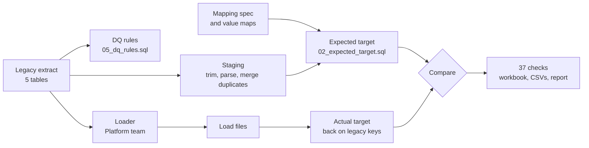

# Reconciliation strategy

| | |
|---|---|
| Document ID | BPM-DW-05 |
| Programme | Billing Platform Migration (BPM), data workstream |
| Client | Northstar Systems, Inc. (fictional) |
| Version | 1.3 |
| Date | 2026-10-13 |
| Author (role) | Senior Technical Business Analyst, data workstream lead |
| Approved by | Robert Chen, Controller |
| Status | Approved |

> Fictional client; generated extract. The checks below are implemented in `recon/sql/` and run by `scripts/run_mock.py`.

## The principle

The loader can't mark its own homework. Its logs say what it did, not what it should have done.

So the reconciliation builds its own picture of what the target should contain, straight from the legacy extract and the mapping spec, and compares that with what the platform actually holds (DEC-BPM-001). The expected target is written in SQL by the data workstream; the loader is Python owned by the Platform team. Neither reads the other's code. If both misread the same rule the reconciliation can't see it, which is why every mapping rule was walked through with Finance or Billing Ops before either side built it.

Records are matched on legacy keys (invoice number, payment id and so on), which the platform stores on every record. The platform's own ids are never used to match.

## Five levels of check

| Level | Question it answers | Checks |
|---|---|---|
| L1 Completeness | Did every record that should arrive arrive exactly once, and nothing else? | 6 |
| L2 Control totals | Do counts and money agree by the cuts Finance and Billing Ops use? | 10 |
| L3 Field level | For every matched record, does each mapped field hold what the mapping says it should? | 5 |
| RI Integrity | Inside the target, does every link resolve, does every invoice add up, and is no transaction dated after the extract? | 11 (10 in mock 1) |
| L4 Finance views | Do receivables, aging, customer balances, and billing and cash for the extract month agree? | 5 |

Each level catches things the others miss. L2 can balance while two invoices have swapped customers; L3 catches that. The integrity checks look only at the target, so they don't depend on the expected target being right: if the reconciliation and the loader misread a rule the same way, a broken link or an invoice that doesn't add up still shows there. L4 is there because the Controller signs off on receivables, billing and cash, not on 37 check ids.

### The checks

| Check | Entity | What it proves |
|---|---|---|
| RC-L1-01 | customers | Every in-scope customer loaded exactly once, nothing extra |
| RC-L1-02 | subscriptions | Every in-scope subscription loaded exactly once, nothing extra |
| RC-L1-03 | subscriptions | Platform rejected exactly the expected records |
| RC-L1-04 | invoices | Every in-scope invoice loaded exactly once, nothing extra |
| RC-L1-05 | credit notes | Every in-scope credit note loaded exactly once, as a credit note |
| RC-L1-06 | payments | Every in-scope payment loaded exactly once, nothing extra |
| RC-L2-01 | customers | Customers by status and billing hold |
| RC-L2-02 | customers | Customers by country and currency |
| RC-L2-03 | subscriptions | Subscriptions and seats by status |
| RC-L2-04 | subscriptions | Subscriptions and seats by plan |
| RC-L2-05 | invoices | Invoice count and total by currency and month |
| RC-L2-06 | invoices | Invoice count, total and amount due by status |
| RC-L2-07 | invoices | Invoice tax by currency |
| RC-L2-08 | credit notes | Credit note count and total by currency |
| RC-L2-09 | payments | Payment count and amount by currency and month |
| RC-L2-10 | payments | Unapplied payments by currency |
| RC-L3-01 | customers | Field-level match on the customer fields in coverage |
| RC-L3-02 | subscriptions | Field-level match on the subscription fields in coverage |
| RC-L3-03 | invoices | Field-level match on the invoice fields in coverage |
| RC-L3-04 | credit notes | Field-level match on the credit note fields in coverage |
| RC-L3-05 | payments | Field-level match on the payment fields in coverage |
| RC-RI-01 | subscriptions | Subscription points at a loaded customer |
| RC-RI-02 | invoices | Invoice points at a loaded customer |
| RC-RI-03 | invoices | Invoice subscription link resolves |
| RC-RI-04 | credit notes | Credit note points at a loaded invoice |
| RC-RI-05 | payments | Payment points at a loaded customer |
| RC-RI-06 | payments | Applied payments link to an invoice; unapplied do not |
| RC-RI-07 | subscriptions | Plan is one of the mapped platform plans |
| RC-RI-08 | invoices | Invoice currency matches the customer |
| RC-RI-09 | payments | Payment currency matches its invoice |
| RC-RI-10 | invoices | Invoice amounts add up (total, paid, due) |
| RC-RI-11 | all | No invoice, credit note or payment dated after the extract date (from mock 2) |
| RC-L4-01 | receivables | Open receivables by currency |
| RC-L4-02 | receivables | Receivables aging by currency and bucket |
| RC-L4-03 | receivables | Balance of every customer with money owed or cash on account |
| RC-L4-04 | billing | Net billing for the extract month by currency (invoices that aren't void, less credit notes) |
| RC-L4-05 | cash | Cash received in the extract month by currency |

For L2 and L4, "compared" in the results counts rows, and a cut with two measures (a count and an amount) is two rows. So 100 currency-month cuts of payments are 200 compared rows.

### The L1 bridge

For every entity, the legacy row count has to break down exactly:

legacy rows = merged duplicates + out of scope + expected rejects + expected loads

and then expected loads are compared with actual loads key by key, in both directions, and every legacy key in the target is checked for being loaded more than once. A count that matches is not enough: 444 missing invoices and 444 unexpected ones would balance, and so would one invoice loaded twice alongside one that never arrived. An unbalanced bridge fails the check as well.

## Tolerance

Zero (DEC-BPM-010). A difference of one cent fails the check. Where the legacy data itself is a cent out (DQ-08), the expected target carries the legacy value, so the platform has to match legacy exactly; a cent of difference then means the platform changed something.

## Field coverage for L3

Coverage is set per run in `config/mock1.json` and `config/mock2.json`.

| Entity | Mock 1 | Added for mock 2 |
|---|---|---|
| customers | name, email, country, currency, status, invoice_hold, merged_legacy_ids | created_date |
| subscriptions | customer, plan_id, quantity, start_date, end_date, status, cancel_reason | |
| invoices | customer, subscription, invoice_date, due_date, currency, subtotal, tax, total, amount_paid, amount_due, status | |
| credit notes | customer, invoice, credit_date, currency, subtotal, tax, total | |
| payments | customer, invoice, currency, amount, unapplied | paid_date, method |

Mock 1 coverage was every field Finance named as sign-off critical, plus invoice date because of profiling finding 12. Payment date was left to the month-level check, RC-L2-09. That was the wrong call: profiling had shown more evening time stamps on payments than on invoices. In mock 1, RC-L2-09 was failing in every cut because of DEF-BPM-003, and the whole check was filed under that defect. Its "USD 2026-10" cut, the evidence of DEF-BPM-007, went unread.

After DEF-BPM-001 showed the loader converting time stamps, coverage was extended to every date the loader writes, and RC-RI-11 was added to fail any invoice, credit note or payment dated after the extract date (DEC-BPM-011). The new checks were not run against mock 1's load files that day, so DEF-BPM-007 waited for mock 2, which found it both ways.

Three rules come out of that and are now part of this strategy:

1. When a check fails for a known reason, its failing lines are still read one by one. A check that is already failing stops protecting you against anything else.
2. A field that matters to sign-off goes into L3 coverage, even if a control total is supposed to watch it.
3. When a check is added, the previous mock's load files go through it the same day.

## How a difference is handled

Every difference ends up in one of three places, and nowhere else:

1. **Expected transformation.** The mapping says the value should change: duplicates merged, credit notes split, retired plans mapped. These are built into the expected target, so they never show as differences. They are listed in the mock reports so Finance can see what changed and why.
2. **Accepted data exception.** A problem in the legacy data that the business has decided to carry over as is, with a named owner. Each one needs Robert Chen's approval and is listed in the exception register (`08_mock2_reconciliation_report.md`). They are also built into the expected target.
3. **Defect.** The target differs from what the mapping says. Raised against the migration build in `07_defect_log.md` with the failing checks as evidence.

There is no fourth bucket for "explained" or "timing". If a difference can't be put in one of the three, it stays open.

## Go/no-go criteria

| ID | Criterion |
|---|---|
| GC-01 | All L1 completeness checks pass |
| GC-02 | All L2 control totals pass, or every difference traces to an open defect with an agreed fix |
| GC-03 | No L3 difference on any money field; any other difference traces to an open defect with an agreed fix |
| GC-04 | All integrity checks pass |
| GC-05 | Open receivables, aging, customer balances, and billing and cash for the extract month match exactly |
| GC-06 | No open Critical or High defect |
| GC-07 | Every accepted exception has an owner and Robert Chen's approval |
| GC-08 | The data steps of the runbook have been rehearsed end to end on a fresh extract |

The recommendation against these criteria is in `10_go_no_go_recommendation.md`.

## Outputs of a run

`python scripts/run_mock.py mock2` rebuilds the load files and writes to `results/mock2/`:

| File | Content |
|---|---|
| `Northstar_BPM_Reconciliation_Mock2.xlsx` | The workbook Finance reviews: summary, one sheet per level, source DQ |
| `checks.csv` | One row per check with the result |
| `l1_bridge.csv`, `l1_key_differences.csv` | The completeness bridge and every missing or unexpected key |
| `l2_control_totals.csv` | Every cut and measure, expected, actual, difference |
| `l3_field_summary.csv`, `l3_field_differences.csv` | Mismatches per field, and every one of them by record |
| `integrity_issues.csv` | Every broken link or bad invoice arithmetic |
| `l4_finance.csv` | Receivables, aging, balances, billing and cash for the extract month |
| `accepted_exceptions.csv` | Every in-scope record carried over under EX-01 to EX-04 |
| `summary.json` | Totals used by the reports and the tests |

## Changes

| Version | Date | Change |
|---|---|---|
| 1.0 | 2026-09-16 | Approved by Robert Chen with zero tolerance (DEC-BPM-010) |
| 1.1 | 2026-09-30 | L4 added at Finance's request: aging, customer balances, billing and cash for the extract month |
| 1.2 | 2026-10-07 | Mock 2 coverage extended and RC-RI-11 added (DEC-BPM-011) |
| 1.3 | 2026-10-13 | After mock 2: how DEF-BPM-007 was missed in mock 1 recorded, three rules added; L1 also fails on a record loaded twice or an unbalanced bridge; GC-05 includes cash; credit notes carry no balance (DEC-BPM-012) |
